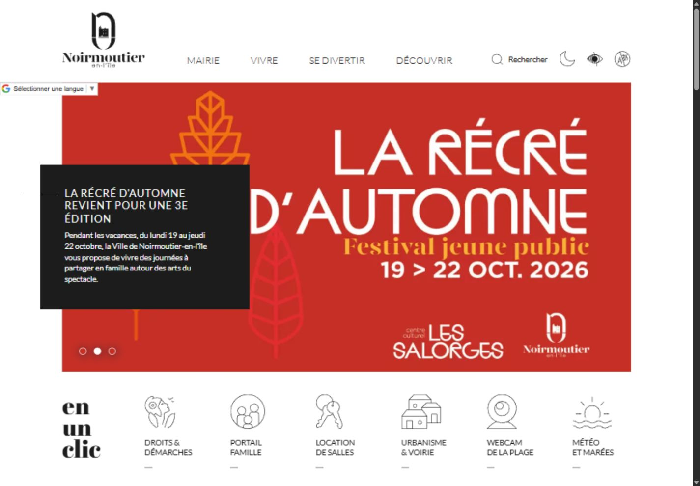
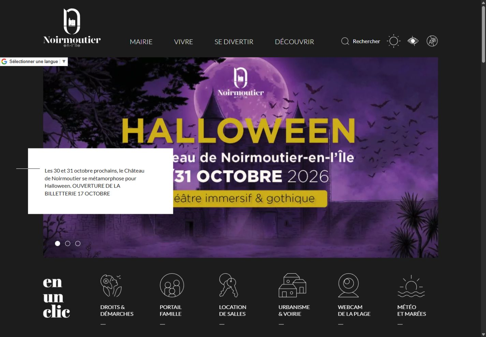
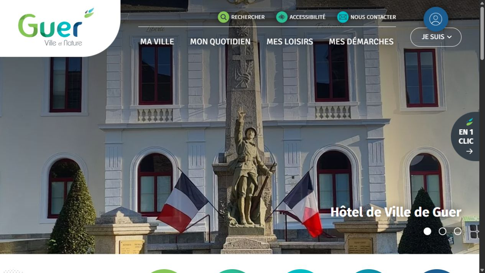
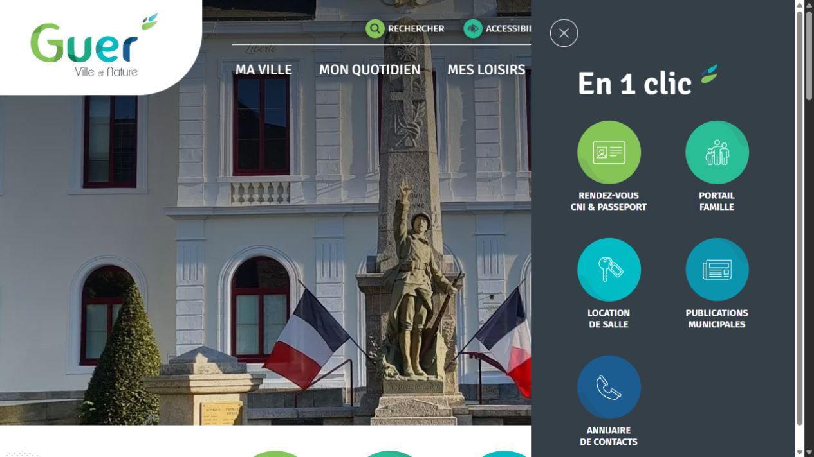
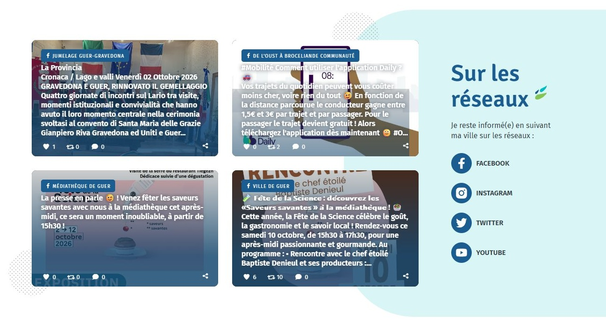
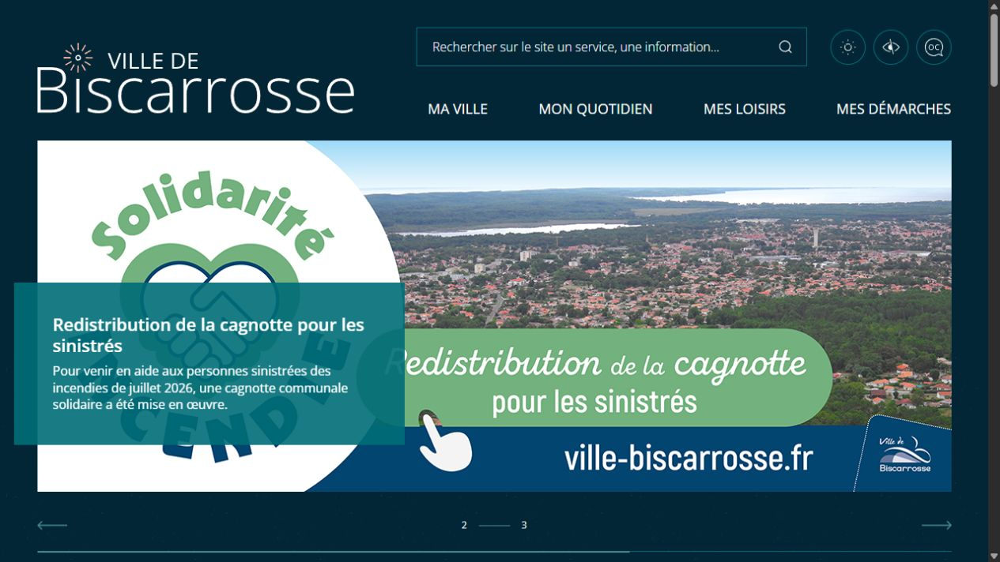
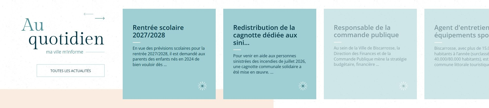
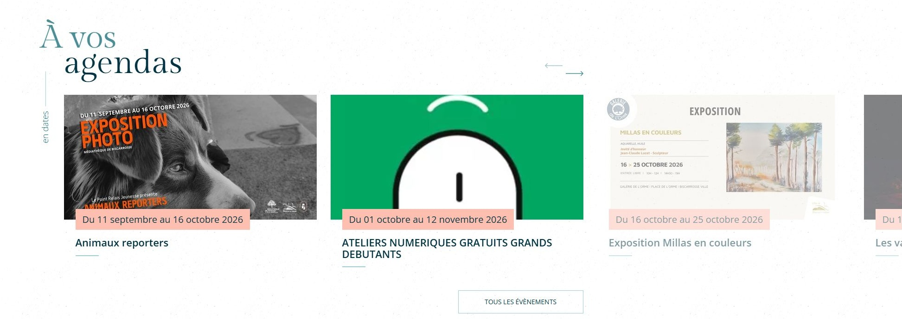

# Keven PEDRONO — Références professionnelles d'intégration web réalisées chez Créasit

Trois sites WordPress réalisés chez **Creasit**, présentés pour illustrer mon travail d’**intégrateur front-end** : intégration d’interfaces à partir de maquettes, composants interactifs et adaptation à des contenus administrables.

**Les maquettes ont été réalisées par l’équipe design de Creasit.** Mon rôle était celui d’intégrateur front-end.

> Ce dépôt présente seulement des références et des captures d’écran. Le code source appartient à l’agence et/ou aux clients et n’est pas publié ici.

| Référence                            | Année | Ce que le projet illustre                                | Technologies                                              |
| ------------------------------------ | ----- | -------------------------------------------------------- | --------------------------------------------------------- |
| [Noirmoutier](#ville-de-noirmoutier) | 2020  | Thèmes clair/sombre et animations au scroll              | HTML, CSS, JavaScript, WordPress, ACF, CPT                |
| [Guer](#ville-de-guer)               | 2022  | Navigation adaptative et adaptation d’un composant tiers | HTML, SCSS, JavaScript, npm, Webpack, WordPress, ACF, CPT |
| [Biscarrosse](#ville-de-biscarrosse) | 2022  | Slider temporisé et carrousels tactiles                  | HTML, SCSS, JavaScript, npm, Webpack, WordPress, ACF, CPT |

## Ville de Noirmoutier

**Projet réalisé en 2020.**

**Ce que ce projet illustre :** intégration d’une interface proposant deux thèmes visuels (clair et sombre) et mémorisant le choix de l’utilisateur.

### Ma contribution

- Intégration en **HTML, CSS et JavaScript**.
- Mode clair/sombre activable par un bouton, avec mémorisation du choix utilisateur.
- Gestion des thèmes à l’aide de **variables CSS**.
- Animations d’apparition au scroll.
- Intégration de contenus administrables WordPress avec **ACF** et **Custom Post Types (CPT)**.

### Aperçu : clair / sombre

| Thème clair                                                                                | Thème sombre                                                                                  |
| ------------------------------------------------------------------------------------------ | --------------------------------------------------------------------------------------------- |
|  |  |

[Visiter le site de Noirmoutier](https://www.ville-noirmoutier.fr/)

## Ville de Guer

**Projet réalisé en 2022.**

**Ce que ce projet illustre :** adaptation de la navigation au défilement et intégration graphique et sémantique d’un composant tiers.

### Ma contribution

- Intégration en **HTML, SCSS et JavaScript**, avec **npm et Webpack**.
- Header sur **deux niveaux**, devenant sticky sur **un seul niveau** au défilement.
- Sidebar sticky **« En 1 clic »**, masquée sur mobile.
- Adaptation d’un **social wall Facebook fourni par un plugin tiers** : restylisation et adaptation sémantique à la maquette.
- Intégration de contenus administrables WordPress avec **ACF et CPT**.

### Aperçus

_Header initial sur deux niveaux._

Voir la sidebar et le social wall

_Sidebar « En 1 clic » ouverte._

_Vue complète du mur social : quatre cartes Facebook restylées, accompagnées du titre « Sur les réseaux » et des liens vers les réseaux sociaux._

[Visiter le site de Guer](https://www.ville-guer.fr/)

## Ville de Biscarrosse

**Projet réalisé en 2022.**

**Ce que ce projet illustre :** mise en valeur des actualités et des événements grâce à des diaporamas et des carrousels faciles à parcourir, sur ordinateur comme sur mobile.

### Ma contribution

- Intégration en **HTML, SCSS et JavaScript**, avec **npm et Webpack**.
- Slider **« À la une »** avec auto-défilement, barre de progression, flèches et pagination.
- Prise en compte des réglages côté back-office pour les **contenus, leur ordre et la durée d’affichage** du slider.
- Carrousels débordants avec flèches et pagination, **tactiles sur mobile**.
- Animations au scroll.
- Intégration de contenus administrables WordPress avec **ACF et CPT**.

### Aperçus

_Slider principal : contenu mis en avant, flèches, pagination et barre de progression._

Voir les carrousels d’actualités et d’agenda

_Carrousel « Au quotidien » en vue desktop large : cartes visibles sur toute leur hauteur, flèches de navigation et prolongement du carrousel au-delà de la zone centrale, jusqu’au bord droit._

_Carrousel « À vos agendas » en vue desktop large : visuels, dates et titres des événements, flèches de navigation et cartes débordantes à droite._

[Visiter le site de Biscarrosse](https://www.ville-biscarrosse.fr/)

---

Les captures ont été réalisées sur les sites publics le **13 octobre 2026**. Vous pouvez cliquer sur les images pour les afficher en grand.

Les captures montrent l’état des sites à cette date, les contenus et interfaces ont peut-être évolué depuis.
